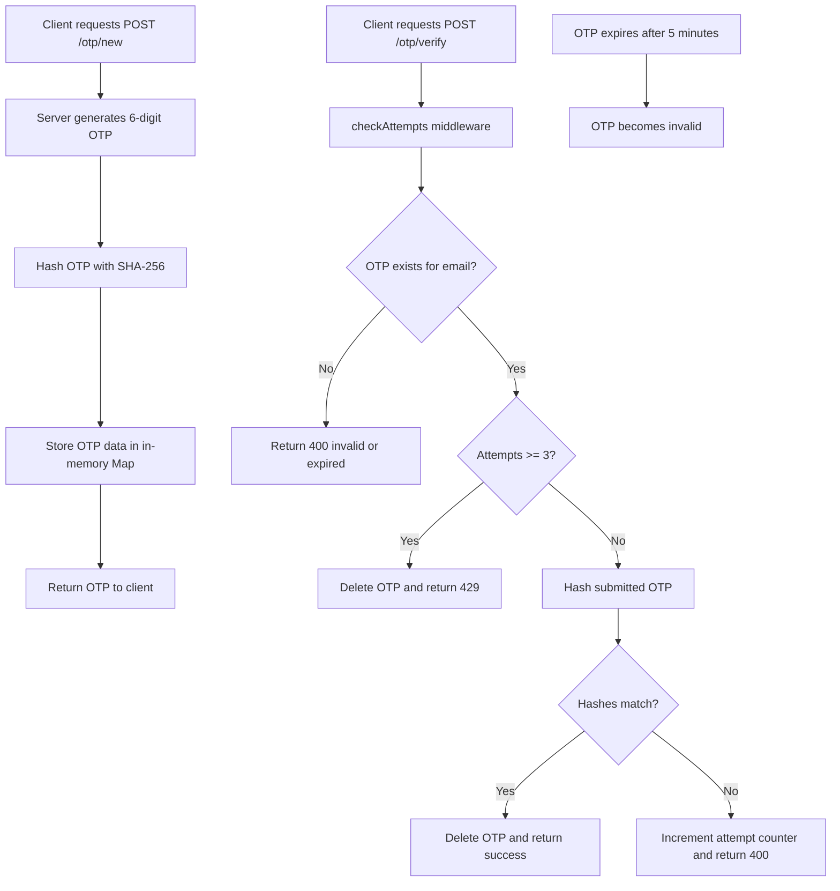

# OTP API (Under development)

This project is a small Express-based OTP authentication simulator. It generates 6-digit one-time passwords, stores them in memory for a short time, and lets you verify them through a simple HTTP API.

## What this is

The app demonstrates a basic OTP flow without a database or external SMS/email provider. OTP records are kept in an in-memory `Map`, hashed with SHA-256, and deleted after successful verification or when they expire.

## How this can be used

You can use this codebase to:

- prototype an OTP login flow
- test frontend integration against a simple OTP API
- understand the moving parts of OTP generation, verification, expiration, and retry limits
- extend it later with email, SMS, Redis, or persistent storage

## Setup

### Prerequisites

- Node.js 18+ recommended
- npm

### Install dependencies

```bash
npm install
```

### Run the app

```bash
npm run dev
```

The server starts on `http://localhost:3000`.

## API Endpoints

### `GET /`

Returns a basic welcome message.

Response:

```json
"Welcome to the OTP API!"
```

### `POST /otp/new`

Creates a new 6-digit OTP for the provided email address.

Request body:

```json
{
  "email": "user@example.com"
}
```

Response:

```json
{
  "otp": 123456
}
```

Notes:

- The OTP is hashed before storage.
- The OTP expires after 5 minutes.
- The generated OTP is logged in the server console for testing.

### `POST /otp/verify`

Verifies an OTP for the given email address.

Request body:

```json
{
  "email": "user@example.com",
  "otp": 123456
}
```

Response on success:

```json
{
  "message": "Sucess"
}
```

Response on failure:

```json
{
  "message": "Invalid OTP"
}
```

or:

```json
{
  "message": "Invalid OTP or session expired."
}
```

Notes:

- Each email can make up to 3 failed verification attempts.
- After 3 failed attempts, the stored OTP is removed and the API returns HTTP 429.
- On successful verification, the OTP is deleted from memory.

### `GET /otp/list`

Lists the email keys currently stored in memory. This is intended for testing and debugging.

Response:

```json
{
  "otps": ["user@example.com"]
}
```

## Flow Diagram



## Project Structure

```
└── 📁OTP
    └── 📁config
        ├── db.js
    └── 📁controller
        ├── createOTP.js
        ├── listOtp.js
        ├── verifyOtp.js
    └── 📁middlewares
        ├── checkAttempts.js
    └── 📁src
        ├── index.js
    └── 📁utils
        ├── hashOtp.js
    ├── package-lock.json
    ├── package.json
    └── README.md
```

## Important Notes

- This project uses in-memory storage, so all OTPs are lost when the server restarts.
- The API currently returns the generated OTP in the response, which is useful for local testing but not for production use.
