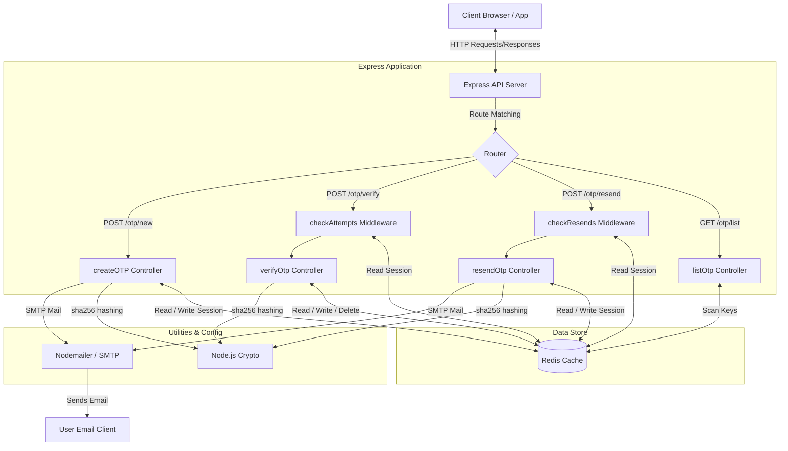
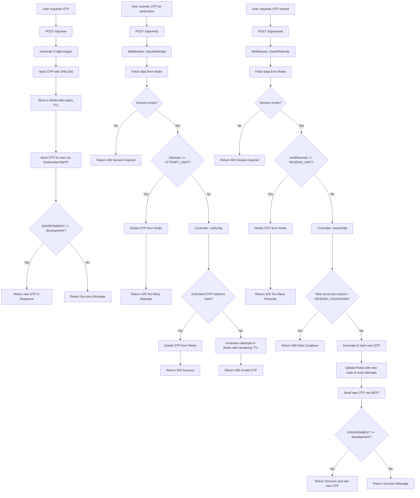

# OTP Authentication API

## Overview

This repository contains an API service that implements a One-Time Password (OTP) generation and verification system. 

The service addresses the need for secure user identity verification via email by generating short-lived, numeric OTPs. It handles sending these codes through SMTP, storing sessions with native expiration in Redis, and checking verification attempts and resend requests using rate-limiting middleware.

This service is designed to be integrated as a microservice into larger architectures requiring secure email verification flows.

## Features

* **Secure OTP Generation:** Generates 6-digit numeric codes using the cryptographically secure pseudo-random number generator (`crypto.randomInt`).
* **Hashed Session Storage:** Hashes OTPs with SHA-256 before storing them in Redis, protecting OTP credentials in transit and at rest in the cache.
* **Native Lifecycle Management:** Restricts OTP validity using native Redis TTL expiration.
* **Brute-Force Mitigation:** Employs middleware (`checkAttempts`) to track failed verification attempts and delete the OTP session immediately upon exceeding thresholds.
* **Resend Rate-Limiting:** Employs middleware (`checkResends`) to restrict total resends allowed per session.
* **Resend Cooldown Enforcement:** Enforces a minimum temporal cooldown between successive resend requests.
* **SMTP Email Delivery:** Dispatches OTPs to user mailboxes via Nodemailer.
* **Developer Diagnostics:** Exposes a developer-only session listing endpoint and returns raw OTP values in HTTP responses when running in development mode.

## Architecture

The system utilizes Express.js for routing, Redis as an ephemeral session cache, and Nodemailer to handle outbound SMTP communications.

### Component Relationship



### Complete OTP Lifecycle Flow



## Tech Stack

* **Runtime:** Node.js (v20-slim base image)
* **Framework:** Express.js (v5.2.1)
* **Cache:** Redis (v6.1.0 Node client, running Redis v7-alpine in container)
* **Email:** Nodemailer (v9.0.3)
* **Utilities:** dotenv, nodemon

## Folder Structure

```
OTP/
├── .dockerignore
├── .env
├── .gitignore
├── docker-compose.yml
├── Dockerfile
├── package.json
├── package-lock.json
├── README.md
└── src/
    ├── index.js
    ├── config/
    │   ├── db.js
    │   └── redis.js
    ├── controller/
    │   ├── createOtp.js
    │   ├── listOtp.js
    │   ├── resendOtp.js
    │   └── verifyOtp.js
    ├── middlewares/
    │   ├── checkAttempts.js
    │   └── checkResends.js
    └── utils/
        ├── hashOtp.js
        └── sendMail.js
```

## Installation

### Prerequisites

* Node.js (v18 or newer)
* npm
* Redis server (if running locally without containers)
* Docker & Docker Compose (optional, for containerized environments)

### Installation

Clone the repository and install the dependencies:

```bash
npm install
```

### Environment Variables

Create a `.env` file in the root directory and populate it with the required configuration values:

```env
ENVIRONMENT=development
PORT=3000
RESEND_COOLDOWN=60000
RESEND_LIMIT=2
ATTEMPT_LIMIT=3
OTP_EXPIRY_TIME=5
SMTP_HOST=smtp.gmail.com
SMTP_PORT=587
SMTP_USER=your_email@gmail.com
SMTP_PASS=your_smtp_app_password
REDIS_URL=redis://localhost:6379
```

### Running Locally

Start the local Redis server on `localhost:6379` first, then run the development script:

```bash
npm run dev
```

### Running with Docker

Build the Docker image:

```bash
docker build -t otp-authentication-api .
```

Run the container (passing environment variables or referencing the `.env` file):

```bash
docker run --env-file .env -p 3000:3000 otp-authentication-api
```

### Running with Docker Compose

To orchestrate the API server alongside a Redis container automatically:

```bash
docker-compose up --build
```

This starts:
* **api** service on port `3000`
* **cache** service (Redis) on port `6379`

## API Documentation

### 1. Root Greeting
* **Method:** `GET`
* **Route:** `/`
* **Purpose:** Simple API status or welcome greeting.
* **Request Body:** None
* **Success Response:**
  * **Code:** 200 OK
  * **Content:**
    ```text
    Welcome to the OTP API!
    ```
* **Error Responses:** None

---

### 2. Generate OTP
* **Method:** `POST`
* **Route:** `/otp/new`
* **Purpose:** Generate, hash, and cache a 6-digit OTP, then dispatch it via email to the specified recipient.
* **Request Body:**
  ```json
  {
    "email": "user@example.com"
  }
  ```
* **Success Response:**
  * **Code:** 200 OK
  * **Content (ENVIRONMENT=development):**
    ```json
    {
      "otp": 582491
    }
    ```
  * **Content (ENVIRONMENT=production):**
    ```json
    {
      "sucess": true,
      "message": "OTP sent sucessfully"
    }
    ```
* **Error Responses:**
  * **Code:** 500 Internal Server Error (e.g. SMTP transmission failed)
  * **Content:**
    ```json
    {
      "error": "Failed to send OTP email"
    }
    ```

---

### 3. Verify OTP
* **Method:** `POST`
* **Route:** `/otp/verify`
* **Purpose:** Validate the submitted OTP code against the cached SHA-256 hash.
* **Request Body:**
  ```json
  {
    "email": "user@example.com",
    "otp": 582491
  }
  ```
  *(Note: Supports wrapping the verification payload under a nested `json` key, e.g., `{ "email": "...", "json": { "otp": 582491 } }`)*
* **Success Response:**
  * **Code:** 200 OK
  * **Content:**
    ```json
    {
      "message": "Success"
    }
    ```
* **Error Responses:**
  * **Code:** 400 Bad Request (Email missing)
  * **Content:**
    ```json
    {
      "message": "Email is required."
    }
    ```
  * **Code:** 400 Bad Request (Invalid OTP value)
  * **Content:**
    ```json
    {
      "message": "Invalid OTP"
    }
    ```
  * **Code:** 400 Bad Request (Session expired or email entry missing)
  * **Content:**
    ```json
    {
      "message": "Invalid OTP or session expired."
    }
    ```
  * **Code:** 429 Too Many Requests (Attempts threshold met; OTP session deleted from Redis)
  * **Content:**
    ```json
    {
      "message": "Too many attempts! Please try again later."
    }
    ```
  * **Code:** 500 Internal Server Error (Verification or lookup failures)
  * **Content:**
    ```json
    {
      "error": "Failed to process verification"
    }
    ```

---

### 4. Resend OTP
* **Method:** `POST`
* **Route:** `/otp/resend`
* **Purpose:** Invalidate the existing OTP and dispatch a newly generated 6-digit OTP code to the email address, subject to cooldown and resend rate limits.
* **Request Body:**
  ```json
  {
    "email": "user@example.com"
  }
  ```
* **Success Response:**
  * **Code:** 200 OK
  * **Content (ENVIRONMENT=development):**
    ```json
    {
      "success": true,
      "otp": 947230
    }
    ```
  * **Content (ENVIRONMENT=production):**
    ```json
    {
      "success": true,
      "message": "OTP resent successfully"
    }
    ```
* **Error Responses:**
  * **Code:** 400 Bad Request (Email missing)
  * **Content:**
    ```json
    {
      "message": "Email is required."
    }
    ```
  * **Code:** 400 Bad Request (No previous OTP found for this email address)
  * **Content:**
    ```json
    {
      "success": false,
      "message": "No OTP found for this email. Please request a new OTP."
    }
    ```
  * **Code:** 400 Bad Request (Cooldown period has not elapsed yet)
  * **Content:**
    ```json
    {
      "success": false,
      "message": "Please wait for 60 seconds before requesting a new OTP."
    }
    ```
  * **Code:** 429 Too Many Requests (Resend count limit met; OTP session deleted from Redis)
  * **Content:**
    ```json
    {
      "message": "Too many resend attempts! Please try again later."
    }
    ```
  * **Code:** 500 Internal Server Error (Resend process or mail transmission failures)
  * **Content:**
    ```json
    {
      "error": "Failed to process or resend OTP"
    }
    ```

---

### 5. List OTPs (Development Mode Only)
* **Method:** `GET`
* **Route:** `/otp/list`
* **Purpose:** Query and display a list of all active session keys (emails) currently in Redis.
* **Request Body:** None
* **Success Response:**
  * **Code:** 200 OK
  * **Content:**
    ```json
    {
      "otps": [
        "user1@example.com",
        "user2@example.com"
      ]
    }
    ```
* **Error Responses:**
  * **Code:** 500 Internal Server Error (Redis scan error)
  * **Content:**
    ```json
    {
      "error": "Failed to retrieve OTP list"
    }
    ```

## Workflow

Requests pass through structured steps inside the application pipeline:

```
Client Request
      ↓
Route Matching & Body Parsing
      ↓
Security Middlewares (checkAttempts / checkResends)
      ↓
Business Logic (verifyOtp / resendOtp / createOTP)
      ↓
Redis Session Store (Read/Write/Delete/TTL)
      ↓
Outbound Action (SMTP email generation via Nodemailer)
      ↓
Client Response (JSON Payload & status code)
```

### Detailed Endpoint Internals

#### A. Generation Flow (`POST /otp/new`)
1. Client submits email payload.
2. Server calls `crypto.randomInt` to generate a 6-digit numeric OTP.
3. Node calls SHA-256 algorithm to hash the OTP.
4. An OTP session object is stored in Redis under the email address as the key.
5. A native Redis TTL is declared on the key for `OTP_EXPIRY_TIME * 60` seconds.
6. The SMTP client sends the plain OTP to the email address.
7. The server checks the `ENVIRONMENT` variable and returns either a success JSON object or the raw OTP (in development).

#### B. Verification Flow (`POST /otp/verify`)
1. Client submits email and verification code payload.
2. `checkAttempts` middleware interceptor queries Redis for the session.
3. If the record exists, the middleware evaluates if `attempts >= ATTEMPT_LIMIT`. If threshold is reached, the key is purged from Redis immediately and a `429` is returned. If clean, control proceeds to the controller.
4. The controller hashes the submitted code and checks for an exact match against the cached SHA-256 string.
5. On match: the session key is purged from Redis and a `200` success payload is returned.
6. On mismatch: the `attempts` count in the session object is incremented, and the payload is rewritten to Redis with the remaining TTL value to preserve expiration time. A `400` invalid code response is returned.

#### C. Resend Flow (`POST /otp/resend`)
1. Client submits email payload.
2. `checkResends` middleware queries Redis for the session.
3. If `totalResends >= RESEND_LIMIT`, the key is purged from Redis to force a full cooldown lock, and a `429` is returned. If clean, control proceeds to the controller.
4. The controller inspects `Date.now() - lastResentAt` to check if it is less than the `RESEND_COOLDOWN` window. If the cooling duration has not elapsed, a `400` is returned.
5. If cooled down, a new 6-digit code is generated and hashed.
6. The session record is rewritten to Redis with the new hash, `attempts` reset to `0`, `totalResends` incremented, and expiration refreshed to `OTP_EXPIRY_TIME * 60` seconds.
7. The new OTP is dispatched to the user via SMTP.

## Security Considerations

Only the following security controls are implemented:

* **One-Time Password Hashing:** OTP codes are hashed via a SHA-256 digest (`crypto.createHash("sha256")`) prior to cache insertion. Only the hash is stored, safeguarding against cache exposure attacks.
* **Brute-Force Protection (Attempt Limiting):** A failed attempt counter is updated in the session cache. Upon reaching the maximum configuration threshold, the session is deleted instantly, preventing further password guessing.
* **Rate-Limiting (Resend Limits):** Outbound email spam is rate-limited by tracking total resend events per session and removing the session from cache once the threshold is crossed.
* **Resend Cooldown Enforcement:** An explicit cooldown check prevents immediate sequential OTP dispatches for the same address.
* **Cache TTL Expiration:** Sessions expire automatically in the Redis cache using native expiration times.
* **Environment-Guided Isolation:** Sensitive secrets, database connections, and rate-limiting limits are configured externally inside `.env`. Development-mode features (like showing plain codes or listing active logins) are deactivated in other environments.

## Testing

Manually test the verification flow and boundary conditions:

### 1. Verification Walkthrough

1. Request a code:
   ```bash
   curl -X POST http://localhost:3000/otp/new \
     -H "Content-Type: application/json" \
     -d '{"email": "tester@example.com"}'
   ```
2. Retrieve the code (if `ENVIRONMENT=development`, fetch it directly from the response JSON; otherwise, retrieve it from the configured email account or console log).
3. Submit the correct code:
   ```bash
   curl -X POST http://localhost:3000/otp/verify \
     -H "Content-Type: application/json" \
     -d '{"email": "tester@example.com", "otp": <RETRIEVED_CODE>}'
   ```
   *Expected response:* `{"message": "Success"}` with status `200`.

### 2. Edge Case Testing

#### Test Cooldown Rules
1. Request a code for `tester@example.com`.
2. Immediately trigger a resend:
   ```bash
   curl -X POST http://localhost:3000/otp/resend \
     -H "Content-Type: application/json" \
     -d '{"email": "tester@example.com"}'
   ```
   *Expected response:* Status `400` stating `"Please wait for 60 seconds before requesting a new OTP."` (assuming `RESEND_COOLDOWN=60000`).

#### Test Attempt Limit Purges
1. Request a code for `tester@example.com`.
2. Send incorrect verification payloads repeatedly:
   ```bash
   curl -X POST http://localhost:3000/otp/verify \
     -H "Content-Type: application/json" \
     -d '{"email": "tester@example.com", "otp": 000000}'
   ```
3. On the 3rd failed attempt (if `ATTEMPT_LIMIT=3`), the session is wiped.
4. Send a 4th request (even if using the actual correct OTP).
   *Expected response:* Status `429 Too many attempts! Please try again later.`.

#### Test Resend Limit Purges
1. Request a code for `tester@example.com`.
2. Wait for the cooldown window (e.g. 60 seconds) to pass.
3. Resend the code.
4. Wait for the cooldown window to pass again.
5. Resend the code a second time.
6. If `RESEND_LIMIT=2`, the third resend request will trigger rate limit block.
   *Expected response:* Status `429 Too many resend attempts! Please try again later.`.

## Configuration

The application is configured using variables in `.env`:

| Variable Name | Data Type | Default Value | Description |
| :--- | :--- | :--- | :--- |
| `ENVIRONMENT` | String | `production` | Run mode config. Set to `development` to expose `/otp/list` and return raw codes in HTTP responses. |
| `PORT` | Integer | `3000` | Port number the HTTP service listens on. |
| `RESEND_COOLDOWN` | Integer | `60000` | Cooldown duration in milliseconds between resend requests. |
| `EXPIRE_TIME` | Integer | `300000` | *Unused in codebase.* |
| `RESEND_LIMIT` | Integer | `2` | Number of OTP resends allowed before locking the session. |
| `ATTEMPT_LIMIT` | Integer | `3` | Number of incorrect verification attempts allowed before locking the session. |
| `OTP_EXPIRY_TIME` | Integer | `5` | Lifespan of an OTP session in minutes. |
| `SMTP_HOST` | String | `smtp.gmail.com` | SMTP host endpoint for sending mail. |
| `SMTP_PORT` | Integer | `587` | Outbound SMTP connection port. |
| `SMTP_USER` | String | *Required* | SMTP login credentials username. |
| `SMTP_PASS` | String | *Required* | SMTP login credentials password or app-specific token. |
| `REDIS_URL` | String | `redis://localhost:6379` | Connection URI for the Redis service. |

## Known Limitations

* **No Persistent Audits:** The system maintains no long-term store. No historical authentication logs or audits are written to database systems.
* **Basic OTP Character Set:** The code generates simple 6-digit integers. Custom alphanumeric lengths are not supported.
* **Missing HTTP Security Headers:** The service does not integrate headers protection libraries like Helmet or CORS policies out of the box.
* **Manual Request Schema Checking:** Request body payloads are validated with simple presence statements rather than robust schema engines (e.g., Zod, Joi).
* **Unprotected Debug Routing:** In development mode, the active sessions table `/otp/list` can be queried by any network client without authentication.

## Future Improvements

- [ ] JWT authentication generation on successful OTP validation
- [ ] Swagger API Documentation Integration
- [ ] Unit and Integration test coverage
- [ ] CI/CD pipeline automation
- [ ] Helmet security headers integration
- [ ] CORS middleware implementation
- [ ] Schema validation via Zod

## Learning Outcomes

* **State Tracking and Lifecycles:** Integrating custom rate limiting states and handling short-lived key expirations directly in Redis.
* **Custom Middleware Pipeline:** Building reusable Express middleware handlers (`checkAttempts`, `checkResends`) to validate criteria before reaching controller routes.
* **Security via Hashing:** Implementing non-reversible SHA-256 storage to secure ephemeral passcode tokens at rest.
* **SMTP Transactions:** Managing programmatic connections to remote SMTP servers via Nodemailer.
* **Multi-Container Orchestration:** Setting up Docker Compose structures linking Express servers to independent cache nodes.

## License

This project is licensed under the [ISC License](LICENSE).

## Author

Yashdeep Singh
