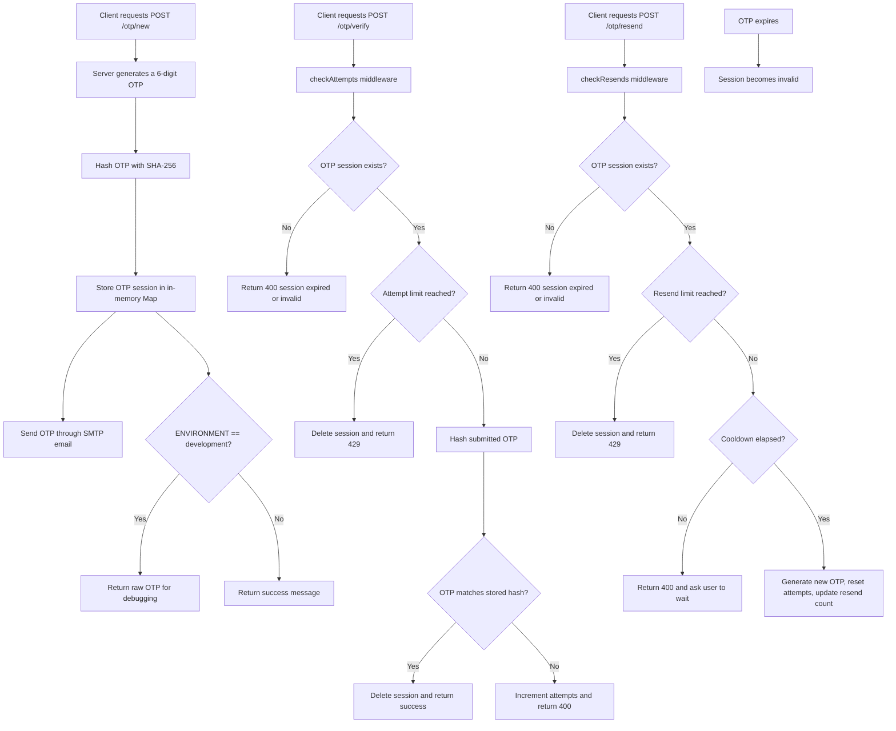

# OTP Authentication API

## Overview

This project is an Express-based OTP authentication API. It generates 6-digit one-time passwords, hashes them with SHA-256, stores OTP sessions in memory, sends OTPs through SMTP, and exposes endpoints to create, verify, resend, and list OTP sessions.

The current implementation is intended for local development, frontend integration testing, and experimenting with the OTP lifecycle without adding a database.

## Implemented Features

- Generate 6-digit OTPs for a supplied email address.
- Hash OTPs before storing them in the in-memory cache.
- Send OTPs through Nodemailer using SMTP settings from environment variables.
- Verify OTPs with attempt limiting.
- Resend OTPs with resend limiting and cooldown handling.
- List active OTP sessions for debugging.
- Remove OTP sessions after successful verification or when limits are exceeded.

## Tech Stack

- Node.js
- Express 5
- dotenv
- Nodemon for development
- Nodemailer for email delivery
- Built-in Node.js `crypto` for OTP generation and hashing

## Project Structure

```text
OTP/
├── config/
│   └── db.js
├── controller/
│   ├── createOtp.js
│   ├── listOtp.js
│   ├── resendOtp.js
│   └── verifyOtp.js
├── middlewares/
│   ├── checkAttempts.js
│   └── checkResends.js
├── src/
│   └── index.js
├── utils/
│   ├── hashOtp.js
│   └── sendMail.js
├── package.json
└── README.md
```

## OTP Flow



## Installation

### Prerequisites

- Node.js 18 or newer
- npm

### Install dependencies

```bash
npm install
```

## Environment Variables

Create a `.env` file in the project root and define the values used by the API:

```env
PORT=3000
ATTEMPT_LIMIT=3
RESEND_LIMIT=3
RESEND_COOLDOWN=30000
OTP_EXPIRY_TIME=5
EXPIRE_TIME=300000
# OTP Authentication API

## Overview

This project is an Express-based OTP authentication API. It generates 6-digit one-time passwords, hashes them with SHA-256, stores OTP sessions in memory, sends OTPs through SMTP, and exposes endpoints to create, verify, resend, and list OTP sessions.

The current implementation is intended for local development, frontend integration testing, and experimenting with the OTP lifecycle without adding a database.

## Implemented Features

- Generate 6-digit OTPs for a supplied email address.
- Hash OTPs before storing them in the in-memory cache.
- Send OTPs through Nodemailer using SMTP settings from environment variables.
- Verify OTPs with attempt limiting.
- Resend OTPs with resend limiting and cooldown handling.
- List active OTP sessions for debugging.
- Remove OTP sessions after successful verification or when limits are exceeded.

## Tech Stack

- Node.js
- Express 5
- dotenv
- Nodemon for development
- Nodemailer for email delivery
- Built-in Node.js `crypto` for OTP generation and hashing

## Project Structure

```text
OTP/
├── config/
│   └── db.js
├── controller/
│   ├── createOtp.js
│   ├── listOtp.js
│   ├── resendOtp.js
│   └── verifyOtp.js
├── middlewares/
│   ├── checkAttempts.js
│   └── checkResends.js
├── src/
│   └── index.js
├── utils/
│   ├── hashOtp.js
│   └── sendMail.js
├── package.json
└── README.md
```

## OTP Flow


## Installation

### Prerequisites

- Node.js 18 or newer
- npm

### Install dependencies

```bash
npm install
```

## Environment Variables

Create a `.env` file in the project root and define the values used by the API:

```env
PORT=3000
ATTEMPT_LIMIT=3
RESEND_LIMIT=3
RESEND_COOLDOWN=30000
OTP_EXPIRY_TIME=5
EXPIRE_TIME=300000
ENVIRONMENT=development
SMTP_HOST=smtp.example.com
SMTP_PORT=587
SMTP_USER=your-email@example.com
SMTP_PASS=your-password
```

- `PORT` sets the server port.
- `ATTEMPT_LIMIT` controls how many failed verification attempts are allowed.
- `RESEND_LIMIT` controls how many resend requests are allowed.
- `RESEND_COOLDOWN` sets the minimum time between resend requests in milliseconds.
- `OTP_EXPIRY_TIME` is used by the create flow and is multiplied by `60 * 1000`, so the value is treated as minutes.
- `EXPIRE_TIME` is used by the resend flow in milliseconds.
- `ENVIRONMENT` controls whether the raw OTP is returned in development responses.
- `SMTP_HOST`, `SMTP_PORT`, `SMTP_USER`, and `SMTP_PASS` configure the SMTP transport used to send OTP emails.

Use plain numeric values in `.env`. The code reads these variables with `Number(...)`, so expressions like `60*1000` will not work.

## Running the Server

```bash
npm run dev
```

The API starts on `http://localhost:3000` by default, or on the value provided in `PORT`.

## API Endpoints

### `GET /`

Returns a simple welcome message.

Response:

```json
"Welcome to the OTP API!"
```

### `POST /otp/new`

Creates a new OTP session for an email address, stores the hashed OTP in memory, and sends the OTP by email.

Request body:

```json
{
  "email": "user@example.com"
}
```

Development response:

```json
{
  "otp": 123456
}
```

Production-style response:

```json
{
  "sucess": true,
  "message": "OTP sent sucessfully"
}
```

### `POST /otp/verify`

Verifies a submitted OTP for an email address.

Request body:

```json
{
  "email": "user@example.com",
  "otp": 123456
}
```

Success response:

```json
{
  "message": "Success"
}
```

Common failure responses:

```json
{
  "message": "Invalid OTP"
}
```

```json
{
  "message": "Invalid OTP or session expired."
}
```

```json
{
  "message": "Too many attempts! Please try again later."
}
```

### `POST /otp/resend`

Generates a new OTP for an existing email session when resend conditions are satisfied, updates the in-memory record, and sends the new code by email.

Request body:

```json
{
  "email": "user@example.com"
}
```

Cooldown failure response:

```json
{
  "sucess": false,
  "message": "Please wait for X seconds before requesting a new OTP."
}
```

Resend-limit failure response:

```json
{
  "message": "Too many resend attempts! Please try again later."
}
```

Development response:

```json
{
  "sucess": true,
  "otp": 123456
}
```

Production-style response:

```json
{
  "sucess": true,
  "message": "OTP resent successfully"
}
```

### `GET /otp/list`

Returns the email keys currently stored in memory for debugging.

Response:

```json
{
  "otps": ["user@example.com"]
}
```

## Security Measures

- OTPs are hashed with SHA-256 before storage.
- OTP data is kept in memory only and is removed after successful verification.
- Verification attempts are capped by `ATTEMPT_LIMIT`.
- Resend requests are capped by `RESEND_LIMIT`.
- Resend requests are throttled with `RESEND_COOLDOWN`.
- Raw OTPs are only returned when `ENVIRONMENT=development`.

## Current Limitations

- OTP data is stored in memory, so it is lost when the server restarts.
- There is no persistent database or distributed cache.
- The API does not currently validate missing request fields or missing environment variables.
- The create flow uses `OTP_EXPIRY_TIME` in minutes, while the resend flow uses `EXPIRE_TIME` in milliseconds.
- Response field names still include `sucess` in a few places, matching the current code.
- The API depends on SMTP configuration to actually deliver emails.

## License

ISC
